<div align="center">

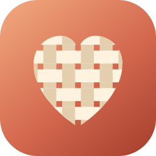

# LifeLoom

**Weave your days together: a private journal, habit tracker, exercise log and personal library in one calm Android app.**

[](https://github.com/amoldalwai/MyDailyDiary/releases/latest/download/MyDailyDiary.apk)
[](https://github.com/amoldalwai/MyDailyDiary/releases/latest)


</div>

---

## 📱 Screenshots

<table>
  <tr>
    <td align="center">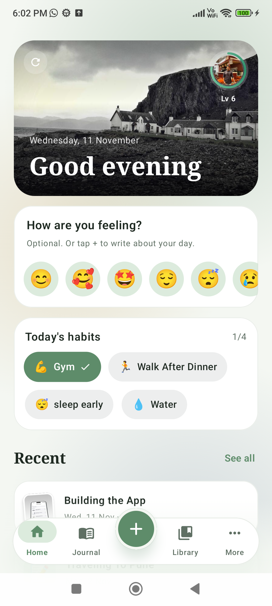<br /><b>Home</b><br />Banner, mood, habits, recent pages</td>
    <td align="center">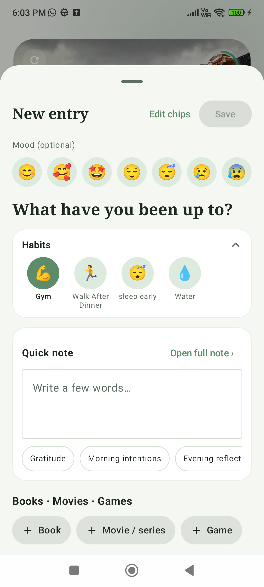<br /><b>Quick Add</b><br />Mood, activities, a note and what you read, played or watched</td>
    <td align="center">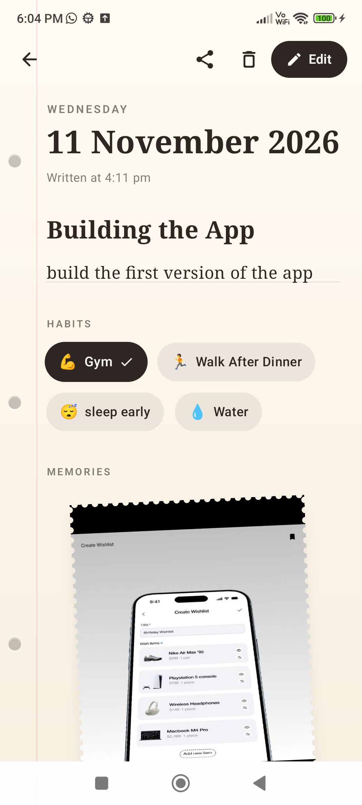<br /><b>A journal page</b><br />Paper look, habits and taped photos</td>
  </tr>
  <tr>
    <td align="center">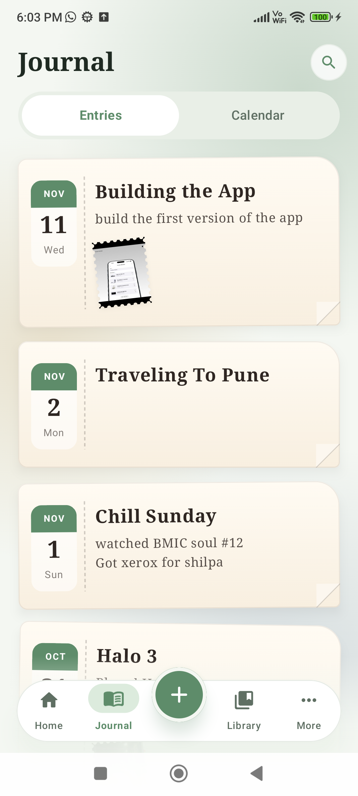<br /><b>Journal</b><br />Every page you've written</td>
    <td align="center">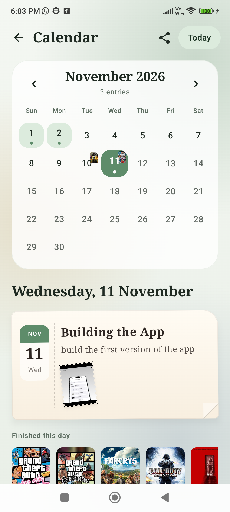<br /><b>Calendar</b><br />Moods, and posters of what you finished</td>
    <td align="center">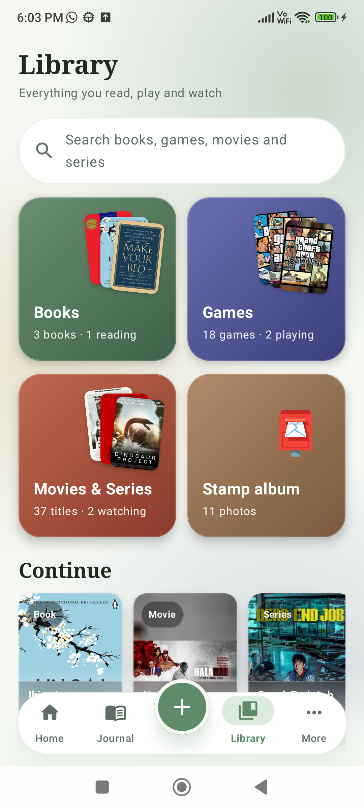<br /><b>Library</b><br />Books, games, movies and series, with search</td>
  </tr>
  <tr>
    <td align="center">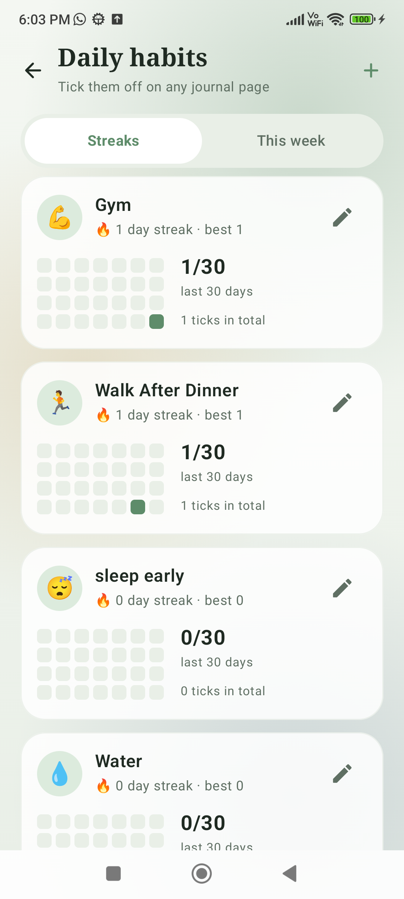<br /><b>Habits, this week</b><br />Last 7 days in one table</td>
    <td align="center">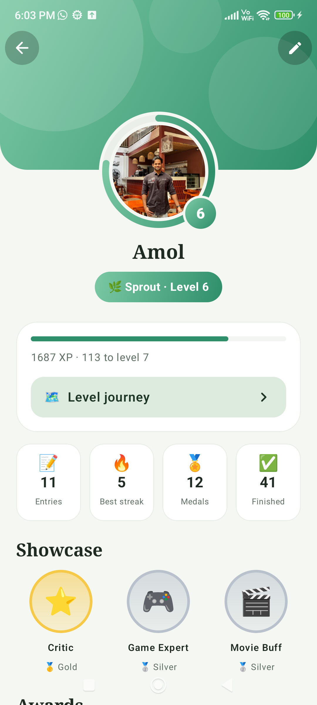<br /><b>Profile</b><br />Level, rank, medals and awards</td>
    <td align="center">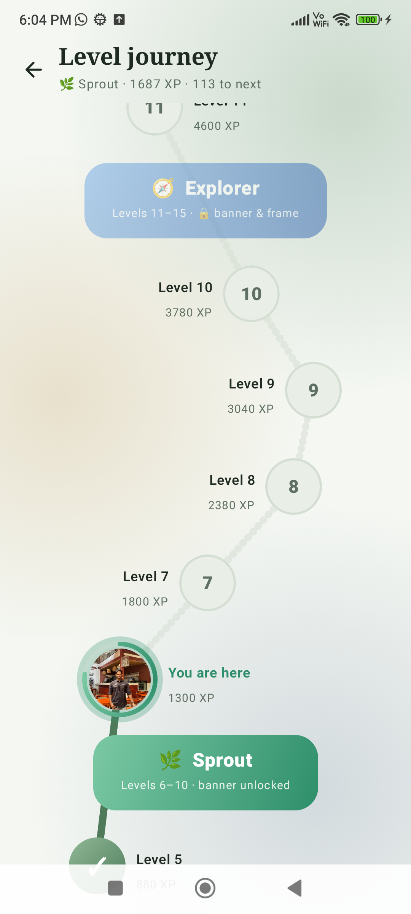<br /><b>Level journey</b><br />A map of 50 levels across 10 ranks</td>
  </tr>
  <tr>
    <td align="center">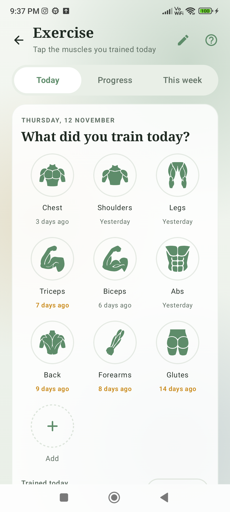<br /><b>Exercise, today</b><br />Tap the muscles you trained</td>
    <td align="center">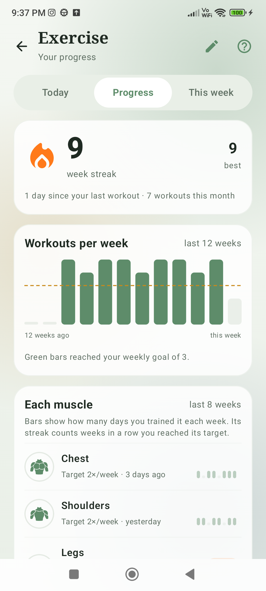<br /><b>Exercise progress</b><br />Week streak and per-muscle streaks</td>
    <td align="center">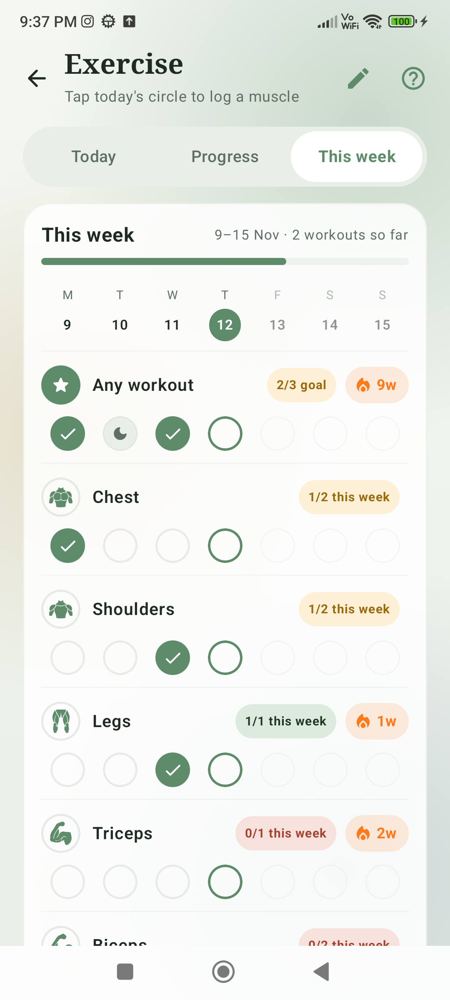<br /><b>Exercise, this week</b><br />Monday to Sunday at a glance</td>
  </tr>
  <tr>
    <td align="center">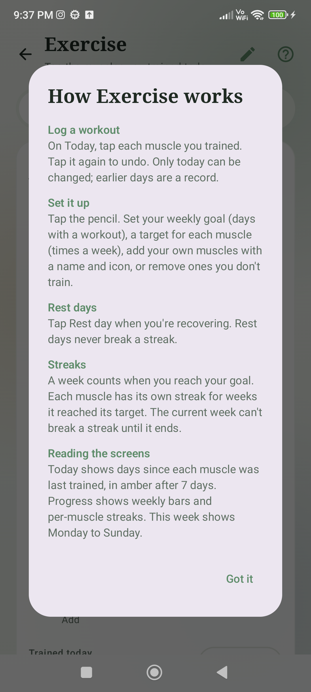<br /><b>Built-in guide</b><br />Tap ? on the Exercise screen</td>
  </tr>
</table>

## ✨ Features

### 📓 Journal
- **Real diary feel**: ruled, dotted or grid pages, margin line, binder holes, taped polaroid photos and a page-turn animation.
- **Make every page yours**: 12 page colours and gradients, 6 fonts, text size, line style and line colour, saved per entry.
- **Rich writing**: bold and italic, moods, tags, voice dictation, stickers and hand drawing.
- **Quick Add**: the fast way to log a day. Pick a mood, tap what you did (Work, Study, Health, Social, Hobbies and your own groups), jot a note from a template, and save. Activity chips can be switched off in Settings.
- **Photos**: add pictures to any page, and browse them all in the stamp album.
- **Find anything**: search text, tags and moods, plus a month calendar with mood markers.
- **On this day** memories, **insights** (streaks, words, mood breakdown, weekly activity) and **PDF export** of an entry, a month or the whole journal.
- **Honest dates**: new pages can be for today or a coming day, not back-dated.

### ✅ Habits
- Add daily habits and tick them from Home, Quick Add or any journal page, with confetti and a chime.
- **Streaks** with best streak and a 28-day history for each habit.
- **This week** tab: habits as rows and the last 7 days as columns, in one glance.
- **Habit nudges**: one friendly question at a time ("Did you complete Gym today?", "Don't break your 5-day streak of Read 🔥"), spaced through a time window you choose. Each habit can be switched off or given its own window, and a **Done** button on the notification ticks it without opening the app. A habit you've done is not asked again that day.

### 💪 Exercise
- Tap the **muscles you trained today** (Chest, Shoulders, Legs, Triceps, Biceps, Abs, Back, Forearms, Glutes) and see how long since each was last trained.
- **Make it yours**: set a weekly goal, a target for each muscle, and add or remove muscles with your own name and icon.
- **Weekly streaks**: an overall streak for weeks you hit your goal and a streak per muscle for weeks it hit its target. Rest days never break a streak.
- **Progress** and **This week** tabs with a weekly bar chart and a Monday to Sunday grid. Past days are read-only.
- A **?** button on the screen explains how it all works.

### 📚 Library
- **Books** (Open Library), **Games** (Steam and Wikipedia) and **Movies & Series** (Wikipedia and TVMaze), with posters, genres, shelves, ratings out of 10 and short reviews.
- **Search across the whole library** from one box.
- **No duplicates**: adding a title you already have reuses it.
- **Attach items to journal pages**: a Books · Movies · Games block at the bottom of every note and Quick Add, with status chips that update your library.
- **Completion celebrations**: finishing a book, game, movie or series sets off confetti, a chime and a banner, and its poster appears on that day in the calendar.
- Posters are stored small to keep the app light.

### 🏆 Progress
- Earn **XP** from entries, photos, streaks, perfect habit days, finished titles, ratings and reviews.
- **50 levels in 10 ranks** (Seedling to Mythic) that get steadily harder, shown on a Candy Crush style **level journey** map.
- **10 awards** in bronze, silver and gold: Bookaholic, Game Expert, Movie Buff, Binge Master, Diarist, Streak Keeper, Photographer, Critic, Habit Hero and Collector.
- **Profile** with your own photo, name, bio and a banner unlocked by rank.
- Animated and audible moments: a splash when you save an entry, a full-screen level-up and rank-up, and award banners.

### 🎨 Personal
- **Welcome slides** on first launch (skippable), and an **interactive tour** that spotlights each feature with Next, Back, Stop and "Try it" buttons. Replay either any time from **Settings → How to guide**.
- 4 colour palettes (Sage, Teal, Lavender, Terracotta), light, dark or system theme.
- A colourful animated banner at the top of Home, or a random photo from your own journal pages if you turn that on in Settings, with a refresh button for another.
- Turn Books, Games, Movies & Series and the activity chips on or off.
- Daily writing reminder that skips days you've already written.

### 🔒 Private by default
- No account, no ads, no analytics, no tracking.
- Entries, habits and photos stay in the app's private storage on your phone.
- Optional PIN and fingerprint lock.
- The internet is used only to search book, game and movie details and fetch posters.

## ⬇️ Install

1. Tap **Download APK** above on your Android phone.
2. Open the downloaded file. If Android asks, allow **Install unknown apps** for your browser.
3. Open **LifeLoom** and start writing.

> Requires **Android 12 or newer**.

## 🛠️ Build from source

```powershell
git clone https://github.com/amoldalwai/MyDailyDiary.git
cd MyDailyDiary
.\gradlew.bat assembleDebug
```

The APK is written to `app/build/outputs/apk/debug/`. You need JDK 17 and the Android SDK (platform 35).

## 🧱 Built with

Kotlin · Jetpack Compose · Material 3 · SQLite · Coil · Open Library · Steam Store · Wikipedia · TVMaze · Picsum

## 🗂️ Google Drive sync

Google Drive sync is switched off for now. The complete implementation is kept on the [`archive/google-drive-sync`](https://github.com/amoldalwai/MyDailyDiary/tree/archive/google-drive-sync) branch.

---

<div align="center">Made with ❤️ for the days worth remembering.</div>
